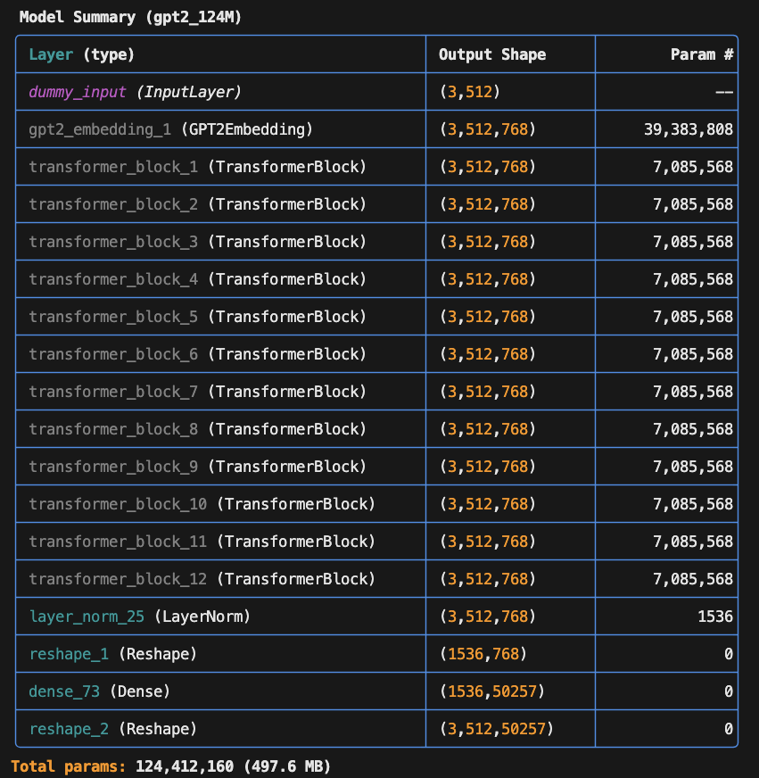
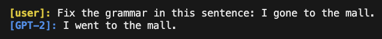

# Welcome to my GitHub! 👋

</img>

## About Me

I'm an undergraduate computer science student at **Loyola Marymount University**. I plan on pursuing a Master's or PhD in the field. My interests include **reinforcement learning**, **human activity recognition**, and **systems and assembly language programming**. I enjoy working on unorthodox projects within technical constraints to gain a deeper sense of understanding.

## Human Activity Research

I conduct undergraduate research in human activity recognition as a part of [HarLab](https://github.com/Har-Lab). I develop and evaluate deep learning architectures for accelerometer-based activity classification, focusing on computational efficiency and generalization across users.

### Publications

- [Accelerometer-Based Acivity Recognition to Support Calorie-Free Feedback in an Intuitive Eating Mobile Platform](https://www.scitepress.org/Link.aspx?doi=10.5220/0014484500004070) | **First Author** | **Presented at [HealthInf 2026](https://healthinf.scitevents.org/?y=2026)**
- Systematic Optimization of a Lightweight Accelerometer-Based Activity Recognition Framework for Calorie-Free Movement
  Feedback | _HealthInf 2026 Extended Publication_ | **First Author** | **Accepted; forthcoming**
- [Accelerometer-Based MET Estimation for Wearable Energy Expenditure Monitoring](https://www.scitepress.org/Link.aspx?doi=10.5220/0014485800004070) | _BIOSTEC 2026_

## Projects

### [Stanley/Penguin Assembler](https://github.com/yaznat/stanley-penguin-assembler)

An assembler and interpreter for the theoretical Stanley/Penguin assembly language and machine, specifed in [CMSI 2210](https://bjohnson.lmu.build/cmsi2210web) at **Loyola Marymount University**.

### [Neural Network in Stanley/Penguin Assembly](https://github.com/yaznat/stanley-penguin-neural-network)

Neural network and complete [MNIST](https://en.wikipedia.org/wiki/MNIST_database) training and evaluation pipeline implemented in Stanley/Penguin assembly.

**Challenges:** single accumulator, fixed-point representation for integer arithmetic, custom-implemented call stack.

### [JFlow - Deep Learning Library in Java](https://github.com/yaznat/jflow-deprecated)

A deep learning library with a Keras-similar interface. Checkpointing, debugging, and complex model creation and training.

**Model Summary Demo:**

</img>

### [GPT-2 In Java](https://github.com/yaznat/gpt2-java)

A complete implementation of **GPT-2 Small** in Java using JFlow. Transformer layers, pretraining, instruction-tuning. Includes trained weights and a chat demo.

**Usage Demo:**

</img>
